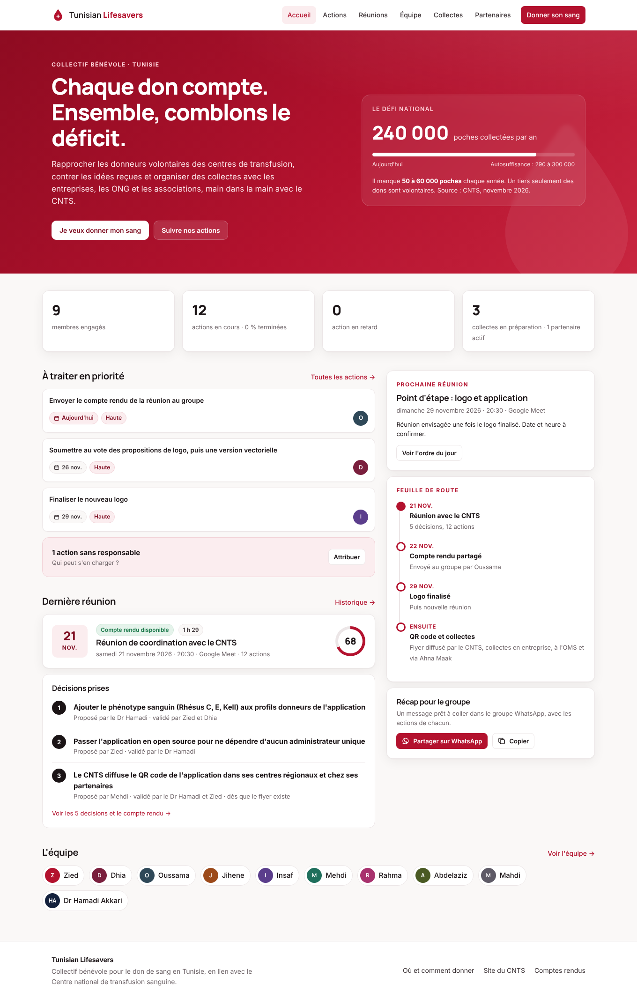

# Tunisian Lifesavers

Site de gestion et de visibilité du collectif bénévole **Tunisian Lifesavers** (don de sang en Tunisie).



## Ce que fait le site

| Page | Contenu |
| --- | --- |
| **Accueil** | Mission, chiffres du CNTS, actions urgentes, actions sans responsable, prochaine réunion, feuille de route, récap WhatsApp prêt à envoyer |
| **Actions** | Tableau (À faire / En cours / Terminée, glisser-déposer) ou liste ; filtres par membre, échéance, recherche ; export CSV |
| **Détail d'une action** | Responsable, échéance, statut, priorité, description, réunion d'origine et minute de l'enregistrement, commentaires, historique, rappel WhatsApp, ajout à l'agenda (.ics avec rappel la veille) |
| **Réunions** | Historique et réunions à venir ; compte rendu complet : résumé, décisions, actions issues, déroulé, questions ouvertes (convertibles en action), note, temps de parole, risques, lien Kelma |
| **Équipe** | Fiches membres avec rôle et charge (actions en cours, en retard) ; page par membre |
| **Collectes** | Pipeline Piste → Contact pris → Planifiée → Réalisée, objectif de poches et progression |
| **Partenaires** | CNTS, OMS, Ahna Maak, Coficab, Croissant-Rouge, Scouts… avec statut et membre référent |
| **Donner son sang** | Page publique : étapes du don, idées reçues, conditions indicatives, lien vers le CNTS |

Les données de départ (`data/seed.json`) viennent de la réunion du 21 novembre 2026 avec le Dr Hamadi Akkari (CNTS), analysée avec Shirokko Kelma.

## Lecture publique, édition par code d'équipe

Tout le monde peut consulter le site. Pour attribuer, modifier ou commenter, un membre clique sur **Espace membres** et saisit le code d'équipe (variable `EDIT_CODE`), partagé dans le groupe WhatsApp. Sans `EDIT_CODE` (en local), l'édition est libre.

## Lancer en local

Aucune dépendance : Node 20 ou plus suffit.

```bash
npm start            # http://localhost:8098
npm test             # tests de l'API
```

Les données vivent dans `data/db.json` (créé à partir de `data/seed.json` au premier lancement, ignoré par git).

## Déployer sur le VPS (Docker)

```bash
git clone https://github.com/akiroussama/Tunisian-Lifesavers.git && cd Tunisian-Lifesavers
cp .env.example .env     # puis choisir un vrai EDIT_CODE
docker compose up -d --build
```

Le conteneur écoute sur `127.0.0.1:8098` ; les données sont dans le volume `lifesavers-data`. Il reste à ajouter un bloc au reverse proxy existant, par exemple avec Nginx :

```nginx
location / { proxy_pass http://127.0.0.1:8098; proxy_set_header Host $host; }
```

Sauvegarde : `docker cp tunisian-lifesavers:/app/storage/db.json ./backup-$(date +%F).json`.

## Structure

```
server.js          serveur HTTP + API JSON (sans dépendance)
public/            site (HTML, CSS, JS vanilla)
data/seed.json     données initiales
test/              tests de l'API (node --test)
```
